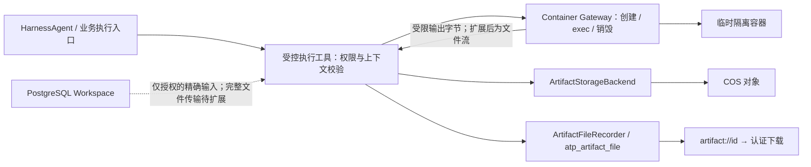
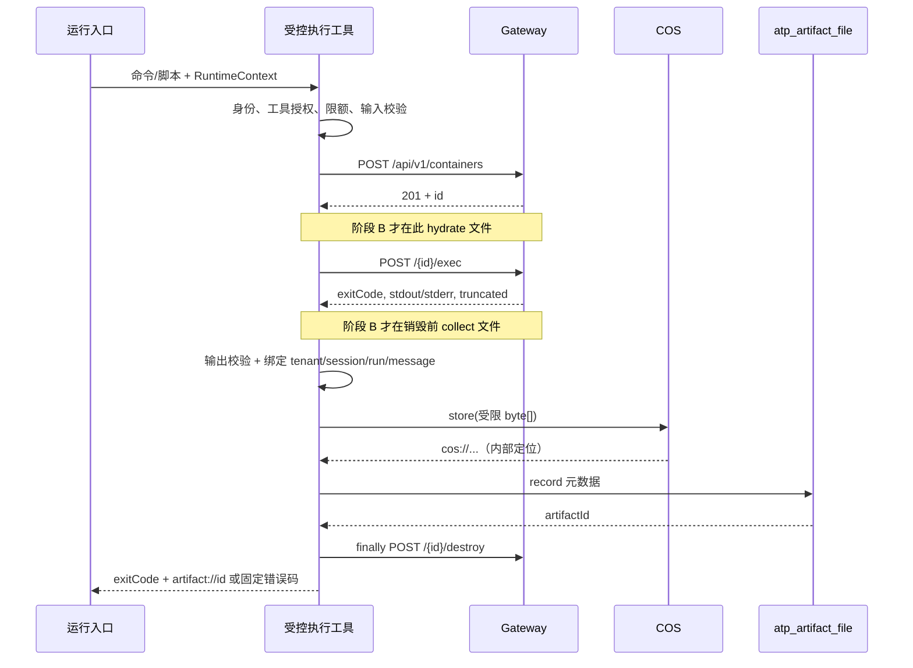

# Docker 隔离执行与 COS 产物交付开发方案

> **历史快照（2026-09-28）**：本文记录当时的设计思路，部分前提已被后续实现取代。当前网关已提供受控文件收发、创建幂等与非 root / 只读系统盘模板；当前能力以 [`../deployment.md`](../deployment.md) 与 [`../developer-guide.md`](../developer-guide.md) 为准。
>
> 术语：COS 指云对象存储；`artifact://id` 指产物引用；PG Workspace 指工作区文件存于 PostgreSQL；SPI 指平台侧存储接口。本文涉及的平台组件不属于本网关仓库。

> 版本：v3.1，2026-09-28；范围：`agent-runtime` 的脚本/命令执行链。基线：AgentScope Java 2.0.3、`docs/developer-guide.md`。PG Workspace 已通过 `shared-filesystem` + PostgreSQL 实现，不在本文开发范围；本文只规划基于 Container Gateway 的 Docker 隔离执行及 COS 产物交付。
>
> **状态：开发设计，不代表执行工具已经上线。** 已验证 Gateway 的 create → exec → destroy/查询 404；尚未实现模型可用的隔离执行工具及 Gateway 文件回收。生产验收前不得把规划能力视为已具备。

## 1. 目标、边界与现状

**目标**：项目内需要执行的脚本/命令不在 `agent-runtime` 宿主机进程执行。每次受控工具调用创建一只 Gateway 管理的 Docker 容器，在容器中运行，成功登记的输出进入现有 `artifact-storage-type: cos` 后端，返回 `artifact://{id}`；最后销毁容器。用户下载仍走平台认证、归属校验和已有产物下载链。

**范围约束**：这里的“项目内涉及执行”指经平台工具编排、需执行不可信或模型生成命令的入口；接入前必须盘点现有入口并逐一替换或拒绝，不能因为加了 `sandbox_exec` 就宣称所有执行已隔离。构建、启动、部署、数据库运维等可信后台命令不自动纳入，也不能暴露给模型。

| 能力 | 当前事实 | 本方案处理 |
|---|---|---|
| 文件/状态 | `shared-filesystem` 的工作区文件在 PG；AgentState 在 Redis；节点本地模板/索引/scratch 不跨节点 | 保持解耦；不把容器当成 Workspace 真相源 |
| Gateway | `/healthz`、容器 create/get/list、exec、destroy 已有；本地生命周期集成测试已通过 | 复用这些已发布 API，不直连 Docker Engine |
| 执行工具 | `shared-filesystem` 尚未注册专用隔离执行工具；现有 `GatewaySandboxClient` 服务 SDK `sandbox-docker` 路径 | 新增受控工具和一次性编排，不把 legacy 客户端当作完整执行闭环 |
| 产物 | `SandboxArtifactDeliveryTarget` 接 SDK `byte[]` 请求，`ArtifactStorageBackend.store` 也是 `byte[]`；`CosArtifactStorage` 可写 COS，`ArtifactFileRecorder` 登记 `atp_artifact_file` | 显式把本次隔离执行的**受限输出字节**接入存储和登记；现有 SPI 并不会自行收集 Gateway 文件 |
| Gateway 文件交换 | **没有 archive/cp、stdin 上传或文件下载接口**；exec 单流最大 65536 字节且可能截断 | 小文本可走 exec 返回值；通用二进制/大文件必须先扩展 Gateway，否则禁止承诺交付 |
| 幂等/归属 | create 非幂等，不接受客户端 requestId；Token 只映射 clientId，无 tenant/user/session/run 隔离 | 平台先做业务身份校验、短期容器台账和限额；要达到服务端强隔离须扩展 Gateway |

### 1.1 之前 vs 现在

| 维度 | 旧文档中的期望 | 本次方案与实际约束 |
|---|---|---|
| 文件传输 | 直接调用 `PUT/GET .../archive` | **当前不存在**；作为 Gateway 服务端扩展，未发布前只做受限文本模式 |
| 创建幂等 | 客户端 `X-Request-Id` 重放返回同一容器 | **当前不支持**；响应不明时禁止直接重复 create |
| 归属 | Gateway 逐 tenant/user/session/run 授权 | **当前仅按 Token/clientId**；平台必须再校验，服务端强边界仍待补 |
| 输出 | 认为容器 `/workspace/out` 可被平台收集 | 当前只能取得有限 stdout/stderr；不能把容器文件视作已持久化 |
| 存储 | 抽象“COS/资源服务器” | 本次明确用 `artifact-storage-type: cos`，成功后才返回 `artifact://` |

## 2. 架构与数据职责



| 数据 | 真相源 | 容器退出后 |
|---|---|---|
| Agent 文本工作区 | PG `atp_workspace_store` | 保留，不自动同步进/出容器 |
| AgentState | Redis | 保留，不注入容器 |
| 执行临时文件 | Gateway 容器层 | 销毁后丢失 |
| 可下载文件产物 | COS + `atp_artifact_file` | 已登记后可经平台授权下载 |

**不要混淆**模型看到的命令输出、容器里的文件和 COS 产物：只有字节写入 COS 且元数据登记成功，才是可返回的产物。此阶段不新增 Workspace 表，也不将 stdout 自动回写 PG。

### 2.1 容器安全边界

- 平台只访问 Gateway；凭证只能通过 `ATP_SANDBOX_GATEWAY_TOKEN` 注入，不能写进仓库、模型参数、日志、状态序列化或浏览器。
- Gateway 以镜像白名单限制 `image`；本地联调 `alpine:3.20` 只能执行镜像内已有命令。Python/文档处理需要运维预拉并白名单批准的专用镜像，不能在线 `pip install`。
- 不传 `mounts`、`ports`、hostPath；Gateway 文档中 mount **可由运维开启**，所以应用不传不等于服务端全局禁止，应由运维保持 `GATEWAY_BIND_MOUNTS_ENABLED=false`。禁 privileged、host pid/net、docker.sock；核查服务端实际网络模式（文档默认 bridge，**不能宣称已是 none**），不满足出网控制时禁止运行不可信脚本。
- 一次调用一只容器，不复用跨用户容器；以非 root、只读 RootFS、受限可写目录、CPU/内存/PIDs/磁盘和最大运行时长为上线目标，逐项通过 Gateway 运行配置验证，不能只靠设计文字。
- Token 当前只提供 clientId 边界；所有容器 ID 应留在平台服务端，并按 `(tenantId,userId,sessionId,runId,toolCallId)` 校验和追踪。不能向模型开放 list/get/destroy 任意容器 ID。

## 3. 两阶段交付路线

### 3.1 阶段 A：现有 Gateway 可支持的最小闭环（小文本）

1. 模型只提交命令或脚本文本和有限超时；平台校验调用人、工具授权、文本长度、可用镜像 profile、配额与执行上下文。生成脚本不要落宿主可执行文件：通过受限 shell 参数或 exec `cmd` 内联执行，命令长度须有上限；禁止将秘密写入脚本/`env`。
2. `POST /api/v1/containers` 使用服务端允许的 `image`、有限资源、较短 TTL 和**常驻启动命令**（如 `sleep`）；不能把一次性脚本直接当创建命令，以免 `AutoRemove=true` 时容器先消失。
3. `POST /api/v1/containers/{id}/exec` 执行。现有 `GatewaySandbox.exec` 固定以 `sh -c` 包装命令，不可将它描述为 argv 直传；新工具应显式建模 shell 语义或另做 argv 客户端。stdout/stderr 均按不可信数据处理。非 0 退出是执行结果而非平台故障，不自动重跑。
4. 仅当响应 `truncated=false` 且返回字节数未越限，才可将**明确指定的文本输出**（例如 UTF-8 报表）转换为产物字节，调用 `ArtifactStorageBackend.store(context, fileName, content, maxBytes)`，随后 `ArtifactFileRecorder.record(...)`，返回 `artifact://{id}`。`stdout` 不是容器内任意文件；stderr 不作默认产物。若使用 base64 运送二进制，须严格解码与校验，限制原始文件为远小于 64 KiB 的安全阈值（建议起步不超过 32 KiB），并验证 `truncated=false`、长度及哈希；**本阶段默认不开启二进制**。
5. 无论成功、异常、超时或取消，`finally` 调 `POST /{id}/destroy`（204 幂等）；销毁异常要告警且不能覆盖原始执行/存储异常；无原始异常时不能静默宣称已清理。TTL 仅兜底，不能替代主动销毁。

**阶段 A 限制**：不能读取容器内生成的文件，也不能可靠处理大文本（Gateway stdout 单流 65536 字节，额外含应用层截断与编码开销）；不接受本地/PG/COS 文件作为脚本输入，除非明确的小文本内容经授权后内联且通过尺寸审计。若产品需求是生成 PDF、Excel、图片或多文件产物，必须先进入阶段 B，阶段 A 不算满足该需求。

### 3.2 阶段 B：通用文件产物闭环（依赖 Gateway 服务端扩展）

给 Gateway 增加受控文件上传/下载能力（建议受限 archive/流式文件 API），并配套：

- hydrate：仅选择已授权的当前租户/用户精确工作区路径或当前会话可访问的既有产物；容器只接收本次必需文件，不复制 `AGENTS.md`、整个 `skills/`、提示词、凭证或任意目录。上传到固定 `/workspace/input`，文件数、总量、entry 类型、路径遍历、链接和 SHA-256 双端校验。
- exec：固定工作目录和输出目录 `/workspace/out`；平台控制超时、取消、输出上限。对于执行失败的诊断文件，是否 collect 由产品策略显式决定。
- collect：Gateway 只允许从 `/workspace/out` 输出普通文件，拒绝软/硬链接、绝对路径、`..` 和越界；平台再次验证 entry、总量、文件名、哈希，在容器销毁前取回文件。**现有 `ArtifactStorageBackend` 是 `byte[]` SPI，不是流式接口**：首发若继续复用，只允许每文件 ≤ `artifact-max-bytes` 且受内存总预算约束；大文件必须另增流式存储/登记契约，不得声称现有代码已经流式上传 COS。
- 登记：每个文件先写 COS、再登记 `atp_artifact_file`，只返回登记成功的 `artifact://`；若 COS 成功而登记失败，必须有删除或孤儿清扫补偿。多文件默认逐文件成功/失败汇总，不能虚称全有或全无。
- 治理：Gateway 增加服务端 create 幂等键、容器业务归属复核、全局与租户/用户配额；平台按 Gateway 实际发布契约实现，**不得现在发送不存在的 archive 或假设自定义 `X-Request-Id` 生效**。

在 Gateway 服务端代码/发布环境可用且上述 API 契约和安全测试通过之前，阶段 B 为**阻塞项**，不作为当前已有能力宣称。Gateway 的 `proxy` 请求体默认最多 8 MiB，且要求可映射端口；不能把它未经服务端设计评审就当通用文件出口或绕过出网/鉴权边界。

## 4. 调用时序与失败处理



| 失败点 | 处理 | 自动重试 |
|---|---|---|
| create 前参数/权限不符 | 拒绝、不创建 | 否 |
| create 超时或响应丢失 | **结果不明**；不得再次 create；按本 Token list 并结合平台持久执行记录/可控命名人工或后台核对，不能把名称匹配当业务强隔离 | 否，服务端幂等上线后再调整 |
| exec 超时/取消 | 尝试 stop/destroy，报告超时或取消；Gateway 文档提示超时后命令可能仍运行 | exec 不重试 |
| `truncated=true` 或校验失败 | 不登记产物，销毁并返回输出不可用 | 否 |
| COS 上传/元数据登记失败 | 不返回伪 `artifact://`；记录对象孤儿并补偿 | 按产物幂等策略，不重跑 exec |
| destroy 失败 | 记录容器 ID、阶段和告警，受限重试/核对；TTL 扫描有延迟 | destroy 可重试 |

Gateway 当前按 clientId 默认最多 5 容器、创建 10 次/分、全部请求 60 次/分；平台多实例共用 Token 会共享配额。一次一容器需入口排队或拒绝，不能用单 JVM 信号量代替跨实例限额。Gateway TTL 回收扫描与 grace 会使实际销毁晚于 `ttlSeconds`；`exec` 最大 600 秒、同步 stdout/stderr 各 65536 字节，平台还应设置更紧的限额。

## 5. 接口与配置

### 5.1 已发布 Gateway HTTP 契约

| 动作 | 方法与路径 | 要点 |
|---|---|---|
| 健康 | `GET /healthz` | 免鉴权；不是 `/health` |
| 创建 | `POST /api/v1/containers` | Bearer；`image` 必填，`201` 且立即启动；**非幂等** |
| 执行 | `POST /api/v1/containers/{id}/exec` | `cmd[]`、`timeoutSeconds`、可选 `env`；同步结果带 `truncated` |
| 流式执行 | `POST /api/v1/containers/{id}/exec/stream` | SSE；错误可能是 HTTP 200 内的 `error` 事件；阶段 A 暂不当文件传输 |
| 销毁 | `POST /api/v1/containers/{id}/destroy` | `204`，幂等；清理主动执行 |
| 文件收发 | **当前不存在** | 阶段 B 扩展并另行联调 |

示例（不含真实地址、凭证）：

```json
{"image":"alpine:3.20","cmd":["sleep","3600"],"memoryBytes":268435456,"cpus":1.0,"ttlSeconds":300,"ports":[],"mounts":[]}
```

```json
{"cmd":["sh","-c","printf 'hello\\n'"],"timeoutSeconds":30}
```

### 5.2 平台配置（当前可绑定，不把规划字段冒充现有配置）

`agent-runtime/src/main/resources/application-local.yml` 已有：

```yaml
agent-platform:
  sandbox:
    gateway-base-url: http://gateway.example.com:3010
    gateway-token: ${ATP_SANDBOX_GATEWAY_TOKEN:}
    gateway-image: alpine:3.20
    gateway-ttl-seconds: 3600
    artifact-storage-type: cos
    artifact-max-bytes: 20971520
    cos:
      region: ap-nanjing
      bucket: cos-ai-agent-runtime-1319537263
      object-prefix: artifacts
      auth-mode: ak
      server-side-encryption: AES256
      download-url-ttl-seconds: 300
```

COS 使用环境变量 `COS_SECRET_ID` / `COS_SECRET_KEY`，当前实现到首次存储才检查凭证，**配置为 cos 不等于上传已验证成功**。`gateway-base-url` 当前是 HTTP，Bearer 令牌跨网络明文传输：仅受控本地联调使用；生产必须先具备 HTTPS/可信传输、凭证轮换和网关网络访问控制。`application.yml` 当前 `agui.artifact-max-per-run: 3`；如果要求一次交付更多文件，需同时调整产品限额与该配置，不能沿用旧文档假设的 10。

## 6. 平台实现清单

| 项 | 实现要点 | 当前状态 |
|---|---|---|
| 入口盘点与权限 | 定位所有模型/用户触发的命令、脚本执行入口；默认拒绝未迁移的宿主执行；工具按 Agent/用户授权 | 待实现 |
| 执行客户端 | 基于 Gateway 实际 JSON/错误码封装 create、exec、get、destroy；调用日志脱敏；禁止将 token 序列化 | 待实现；`GatewaySandboxClient` 是旧 SDK 适配，不是本工具 |
| 工具装配 | `shared-filesystem` Harness `Toolkit` 注册受控工具；缺 tenant/user/session/run/message 或权限时 fail-fast | 待实现 |
| 编排 | 一次调用一容器，`try/finally` 清理、取消与超时传播、跨节点占用限额、异常优先级与清理告警 | 待实现 |
| 受限文本产物 | 对未截断的明确 stdout 转 `byte[]`，经 `ArtifactStorageBackend` + `ArtifactFileRecorder`，失败不回假 URI | 待实现；COS 后端和登记组件已存在 |
| 文件交换 | 阶段 B Gateway 服务端扩展 + Platform 输入选择/文件校验/collect | **服务端无 API，阻塞** |
| 二进制/大产物 | 流式 COS 上传与登记补偿；现有 `byte[]` SPI 不能满足 | 待设计/开发 |
| 表结构 | 当前不为 COS 文件另建表，复用 `atp_artifact_file`；如需持久容器运行台账/清扫，再单独设计迁移 | 未新增 DDL |

**建议受控工具逻辑接口**（规划签名，非现有类）：

```java
interface IsolatedCommandExecutor {
    // 校验业务身份和授权后创建一次性容器、执行受限命令并登记可交付输出；结束时清理容器。
    IsolatedExecResult execute(ExecutionContext context, IsolatedExecRequest request);
}
```

对模型只返回固定状态、退出码、受限输出摘要和已登记的 `artifact://`；不返回 Gateway 原始响应、内部容器 ID、完整命令、凭证、COS bucket/key 或预签名 URL。AG-UI 保持工具参数与原始结果默认不外发。

## 7. 测试与上线门槛

| 层次 | 验收断言 |
|---|---|
| 已有联调 | `GatewaySandboxClientIT` 仅 `ATP_GATEWAY_E2E=true` 时联调；create → 容器内脚本得到 `42` → destroy → get 为 404；证明生命周期，不证明 COS 链路 |
| 工具单测 | tenant/user/session/run/message 缺失拒绝；未授权执行拒绝；shell 参数/超时/输出校验；`truncated=true` 不登记；非 0 不自动重试 |
| 编排集成 | 创建失败、响应丢失、429、超时、取消、Gateway 503、销毁失败；每个可确认容器都发 destroy；无法确认时告警/清扫 |
| COS 集成 | 用真实受控测试环境完成执行→输出校验→COS 上传→`atp_artifact_file` 登记→鉴权下载；COS/登记失败无伪 URI，并验证孤儿对象补偿 |
| 安全 | 生产 TLS、无宿主命令旁路、无宿主挂载、无凭证泄漏；确认网络模式、镜像、非 root、RootFS、资源限额和多租户权限 |
| 阶段 B 附加 | Gateway 文件 API 已发布且双方契约测试通过；路径穿越、符号链接、超限、截断、哈希、跨租户 get/exec/collect/destroy、断连与孤儿清扫全部通过 |

**发布门禁**：阶段 A 仅能对外说明“小文本隔离执行与受限文本 COS 产物”；用户要求“生成任意文件并保存到 COS”的完整承诺，必须等待阶段 B 与真实 COS 下载闭环测试通过。当前 Gateway 服务端代码不在本项目，服务端扩展不能仅通过修改平台配置或旧 SDK 客户端完成。

## 8. 本次明确待拍板项

1. 业务首发是否接受**仅小文本输出**，还是必须以 PDF/图片/表格等通用文件产物为首发门槛（后者须先拿到 Gateway 服务端开发与发布能力）。
2. 隔离镜像类型与确切的出网策略：文档默认 `bridge`，对不可信代码必须经运维验证隔离后再开放。
3. 创建响应丢失时容器台账与后台清扫如何持久化、谁拥有跨实例核对权限；Gateway 端幂等和业务归属何时上线。
4. 单次执行的文本/文件数/字节、配额、执行时长及多文件部分成功语义；生产需要专门容量与成本验收。

**结论**：PG Workspace、Redis AgentState 和 Gateway 运行时继续分离；Gateway 负责创建/执行/销毁，平台负责业务授权和 COS 产物登记。已验证的是生命周期；要达到“脚本生成的任意文件可保存并下载”，还缺 Gateway 文件交换与平台收集/交付链，不能用 `artifact-storage-type: cos` 一行配置替代。

